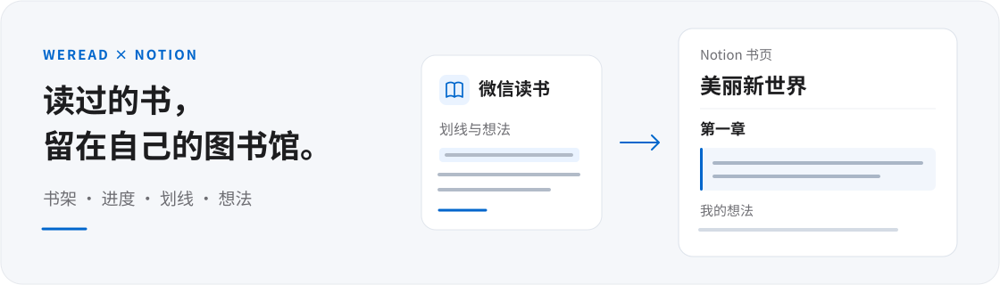
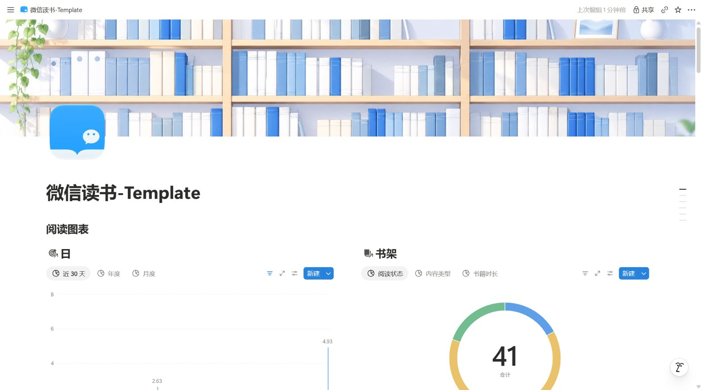
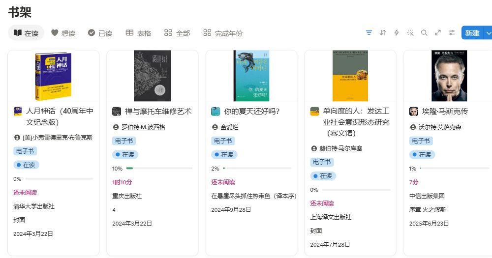
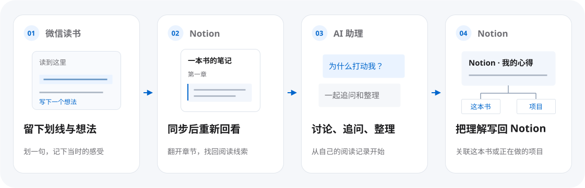

<p align="center">
  
</p>

<h1 align="center">微信读书 × Notion</h1>

<p align="center"><strong>让读过的书，陪你继续思考</strong></p>

<p align="center">在微信读书照常读，书架、进度、划线和想法自动同步到你的 Notion 图书馆，无需自建服务器。</p>

<p align="center">
  <a href="#library-preview"><strong>查看效果</strong></a> · <a href="#quick-start"><strong>让 AI 帮我搭建</strong></a>
</p>

<a name="library-preview"></a>

## 📚 看同步后的图书馆

**上周划的那句话，今天还能找到吗？**




<details>
<summary>展开看阅读进度与统计</summary>




</details>

## 从一句划线，到一个自己的想法

1. **读的时候留下来**：在微信读书划线，顺手写下当时的感受。
2. **同步后重新遇见**：打开 Notion 书页，看看这些句子为什么被你选中。
3. **和 AI 继续聊**：“这段话让我想到最近工作中的问题，帮我一起分析。”
4. **把理解保存下来**：将讨论形成的心得写回 Notion，关联到这本书或自己的项目。

**微信读书负责阅读，Notion 负责沉淀，AI 陪你检索、讨论和整理。**



<a name="quick-start"></a>

## 🚀 一句话开始

把这段话发给能操作 GitHub 和 Notion 的 Agent：

```text
请阅读下面的指南，帮我搭建微信读书 → Notion 图书馆：
https://raw.githubusercontent.com/Quashy/weread2notion-AI/main/docs/AI_SETUP.md
```

Agent 会帮你准备仓库、复制模板并检查首次同步；需要登录或授权时，按提示配合。搭好后，GitHub Actions 负责定时同步，你在微信读书照常读就好。

[手动部署指南](docs/SETUP.md) · [复制 Notion 模板](https://quashy.notion.site/Template-9304aad76d888294b90981a37bbbc42c)

## 📚 它能帮你做什么

### 📚 让书架和进度自动沉淀

手机上照常阅读，GitHub Actions 定时更新你的 Notion 图书馆。书名、作者、封面、阅读状态、进度、时长和当前章节随之归档，无需逐本登记。需要提前刷新时，可以手动运行一次同步。

### ✍️ 让划线和想法不止停留在当下

划线和微信读书里的个人想法按章节保存在书页中。读完后想找一句话、回顾某个观点，直接打开对应书页。自己的读后感可以写在自动同步区域之外，也可以关联到独立的心得页面。

### 💬 和 AI 聊聊书，也聊聊自己

将支持 Notion 的 AI 授权连接到图书馆后，可以从你真实留下的阅读记录开始讨论：

> 帮我回顾《美丽新世界》里我划过的句子，我最关注哪些问题？

> 我不太认同这段话。结合我的笔记，和我讨论一下理由。

> 把我对这本书零散的想法整理成读后感草稿，保留我的观点。

AI 可以帮助检索、追问、归纳和整理；这部分由你使用的 AI 与 Notion 连接提供。同步程序本身无需模型 API，也不会导出整本书正文。

### 🔗 让一本书与其他知识产生联系

把读书心得关联到项目复盘、学习笔记或个人目标。读到一个有启发的观点时，不只是保存一句话，还可以想想：它能改变哪一个正在做的决定？

有权限访问相关页面的 AI，也能帮助你从多本书的已同步记录中查找同一主题，让原本分散的摘录形成联系。

### 📊 看见长期积累

阅读状态、时间统计和每日书籍快照保存在 Notion 原生数据库里。你可以按照自己的习惯调整视图、筛选和布局，在电脑或 Notion 手机端回顾。

## 💬 搭好后，怎么和 AI 一起使用？

先把你选择的 AI 连接到 Notion，并授权它访问这座图书馆。读取用于讨论；写入用于把你确认的心得保存下来。

| 想做什么 | 可以这样说 |
| --- | --- |
| 回顾一本书 | “结合我在这本书里的划线，总结我关注的三个主题，并链接到对应笔记。” |
| 跨书寻找联系 | “找出我的阅读记录中与‘如何做决策’有关的摘录，按观点整理。” |
| 梳理自己的感受 | “先问我几个问题，帮我弄清楚这段话为什么打动我。” |
| 形成读后感 | “根据我的笔记生成草稿，区分原书摘录和我的观点。” |
| 保存讨论结果 | “把刚才确认的想法写到这本书的独立心得区，保留原始书摘。” |

第一次可以只选一本书试试。AI 回答的依据应来自它实际读到的记录，并保留来源链接，方便你回看原文。

<details>
<summary>常见问题</summary>

### 为什么刚划的内容没有马上出现？

默认是每日定时同步。想立即更新，可以在自己的仓库打开 **Actions → weread sync → Run workflow**，保持 `full` 未勾选。

### 从微信读书书架移除一本书，Notion 中会发生什么？

默认开启“只同步我的书架书籍”：成功同步后，对应 Notion 书页及自动内容会移入回收站，历史阅读快照保留。想把 Notion 当作长期图书馆，可以在模板的“设置 → 同步设置”中关闭这一选项。

### 可以修改布局、字段和心得吗？

可以调整首页布局、视图、筛选和排序。程序依赖的数据库名称、字段类型及系统属性应保留；同步管理的字段和自动正文会按微信读书数据更新。重要心得建议放在独立页面，或自动同步标记之外。

### AI 能读到整本书吗？

本项目同步书目信息、阅读记录、划线和个人想法。AI 获得的是你授权给它的 Notion 内容；整本书仍在微信读书阅读。

### Actions 是绿色，就说明全部同步完成了吗？

还要查看 Summary 和日志中的失败书籍。部分书籍读取失败时，程序会保留旧记录并继续同步其他书，下一次普通同步可以重试。排查方法见 [部署指南](docs/SETUP.md#同步遇到问题)。

### 如何更新自己的 Fork？

先查看上游变更，再合并到自己的仓库并运行验证。如果已经二开，建议在分支中处理冲突和测试。代码更新不会自动替换你的 Notion 模板副本。

</details>

## 反馈与贡献

欢迎在 [Issues](https://github.com/Quashy/weread2notion-AI/issues)反馈使用体验、问题和建议，也欢迎提交改进。

反馈时附上复现步骤、脱敏后的错误信息和预期效果；请移除 Key、Token、邮箱和私人笔记。技术结构见 [TECHNICAL.md](docs/TECHNICAL.md)。

## 致谢与许可

本项目基于 [hodgekou/weread2notion-AI](https://github.com/hodgekou/weread2notion-AI) 开发，感谢原作者提供同步工具与 Notion 模板。项目采用 [MIT License](LICENSE)，保留原版权与许可声明。
