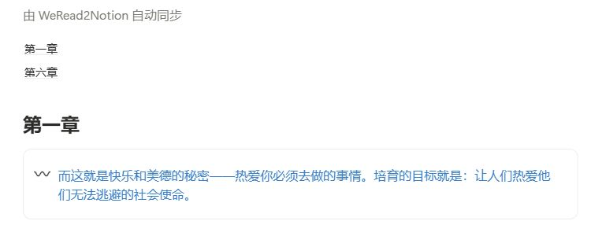
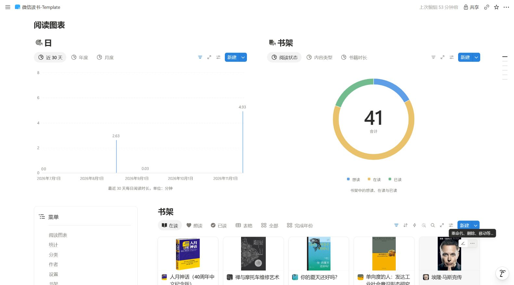

<p align="center">
  
</p>

<h1 align="center">微信读书 × Notion</h1>

<p align="center"><strong>让读过的书，陪你继续思考</strong></p>

<p align="center">在微信读书照常读，书架、进度、划线和想法自动同步到你的 Notion 图书馆，无需自建服务器。</p>

<p align="center">
  <a href="#library-preview"><strong>查看效果</strong></a> · <a href="#quick-start"><strong>让 AI 帮我搭建</strong></a>
</p>

<a name="library-preview"></a>

## 📚 看同步后的图书馆

**上周划的那句话，今天还能找到吗？**




<details>
<summary>展开看阅读进度与统计</summary>




</details>

<a name="quick-start"></a>

## 🚀 一句话开始

把这段话发给能操作 GitHub 和 Notion 的 Agent：

```text
请阅读下面的指南，帮我搭建微信读书 → Notion 图书馆：
https://raw.githubusercontent.com/Quashy/weread2notion-AI/main/docs/AI_SETUP.md
```

Agent 会帮你准备仓库、复制模板并检查首次同步；需要登录或授权时，按提示配合。搭好后，GitHub Actions 负责定时同步，你在微信读书照常读就好。

[手动部署指南](docs/SETUP.md) · [复制 Notion 模板](https://quashy.notion.site/Template-9304aad76d888294b90981a37bbbc42c)

## 💬 同步之后，再和 AI 聊书

把你习惯的 AI 连接到 Notion，并授权它访问这座图书馆，就可以这样问：

> 回顾我在《美丽新世界》里的划线和想法，找出我最关注的三个问题，附上对应笔记。

微信读书负责阅读，Notion 留下记录，AI 陪你继续讨论。

<details>
<summary>常见问题</summary>

### 为什么刚划的内容没有马上出现？

默认是每日定时同步。想立即更新，可以在自己的仓库打开 **Actions → weread sync → Run workflow**，保持 `full` 未勾选。

### 从微信读书书架移除一本书，Notion 中会发生什么？

默认开启“只同步我的书架书籍”：成功同步后，对应 Notion 书页及自动内容会移入回收站，历史阅读快照保留。想把 Notion 当作长期图书馆，可以在模板的“设置 → 同步设置”中关闭这一选项。

### 可以修改布局、字段和心得吗？

可以调整首页布局、视图、筛选和排序。程序依赖的数据库名称、字段类型及系统属性应保留；同步管理的字段和自动正文会按微信读书数据更新。重要心得建议放在独立页面，或自动同步标记之外。

### AI 能读到整本书吗？

本项目同步书目信息、阅读记录、划线和个人想法。AI 获得的是你授权给它的 Notion 内容；整本书仍在微信读书阅读。

### Actions 是绿色，就说明全部同步完成了吗？

还要查看 Summary 和日志中的失败书籍。部分书籍读取失败时，程序会保留旧记录并继续同步其他书，下一次普通同步可以重试。排查方法见 [部署指南](docs/SETUP.md#同步遇到问题)。

### 如何更新自己的 Fork？

先查看上游变更，再合并到自己的仓库并运行验证。如果已经二开，建议在分支中处理冲突和测试。代码更新不会自动替换你的 Notion 模板副本。

</details>

## 反馈与贡献

欢迎在 [Issues](https://github.com/Quashy/weread2notion-AI/issues)反馈使用体验、问题和建议，也欢迎提交改进。

反馈时附上复现步骤、脱敏后的错误信息和预期效果；请移除 Key、Token、邮箱和私人笔记。技术结构见 [TECHNICAL.md](docs/TECHNICAL.md)。

## 致谢与许可

本项目基于 [hodgekou/weread2notion-AI](https://github.com/hodgekou/weread2notion-AI) 开发，感谢原作者提供同步工具与 Notion 模板。项目采用 [MIT License](LICENSE)，保留原版权与许可声明。
